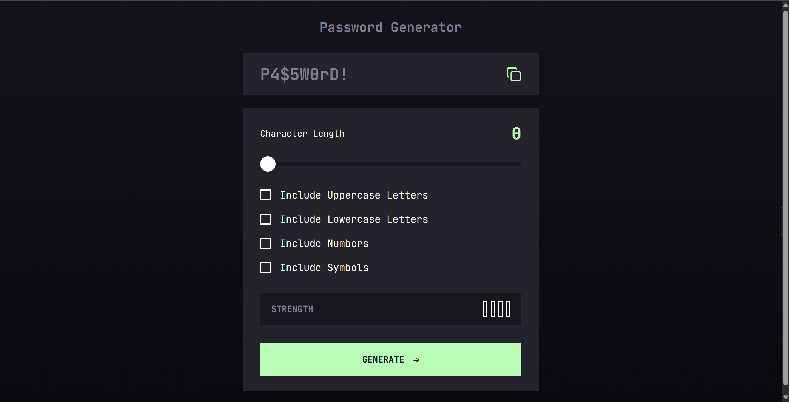
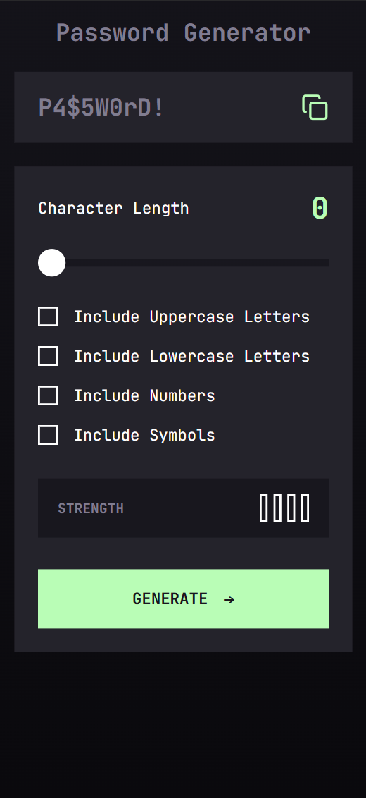

# Password Generator App

A responsive password generator built with React and Tailwind CSS as part of a [Frontend Mentor challenge](https://www.frontendmentor.io/challenges/password-generator-app-Mr8CLycq).

**[Live Demo](https://05-password-generator-app.vercel.app)** ·
**[GitHub Repository](https://github.com/Mario-Balde/05_password-generator-app)**

## Overview

The Password Generator App allows users to generate passwords by choosing a desired length and selecting which character types to include. It features a password strength indicator and a copy-to-clipboard function.

The project focuses on building a responsive, accessible interface with reusable React components and interactive controls.

## Preview




## Features

- Generate passwords with a configurable length.
- Include or exclude uppercase letters, lowercase letters, numbers, and symbols.
- Display a password strength rating based on the selected length and character types.
- Copy the generated password to the clipboard.
- Provide visual feedback for interactive elements, including hover and keyboard focus states.
- Responsive layout for mobile and desktop screens.
- Organised React components and reusable utility functions.

## Built With

- React
- JavaScript (ES6+)
- Tailwind CSS v4
- Vite
- Lucide React
- Web Crypto API for random value generation

## Getting Started

To run the project locally, follow these steps.

### Prerequisites

- Node.js
- npm

### Installation

1. Clone the repository:

   ```bash
   git clone https://github.com/Mario-Balde/05_password-generator-app.git
   ```

2. Navigate to the project directory:

   ```bash
   cd 05_password-generator-app
   ```

3. Install the dependencies:

   ```bash
   npm install
   ```

4. Start the development server:

   ```bash
   npm run dev
   ```

5. Open the local URL displayed in your terminal.

### Available Scripts

| Command           | Description                   |
| ----------------- | ----------------------------- |
| `npm run dev`     | Starts the development server |
| `npm run build`   | Builds the app for production |
| `npm run preview` | Previews the production build |
| `npm run lint`    | Runs ESLint checks            |

## Project Structure

```text
src/
├── components/
│   ├── CharacterLength.jsx
│   ├── PasswordDisplay.jsx
│   ├── PasswordOptions.jsx
│   └── StrengthMeter.jsx
├── utils/
│   ├── calculateStrength.js
│   └── generatePassword.js
├── App.jsx
├── index.css
└── main.jsx
```

The components handle individual parts of the interface, while the utility functions handle password generation and strength calculation.

## What I Learned

While building this project, I practised:

- Managing component state and passing props in React.
- Breaking an interface into reusable components.
- Implementing interactive form controls with Tailwind CSS.
- Generating passwords based on user-selected criteria.
- Providing clipboard functionality and visual feedback.
- Creating responsive layouts and keyboard focus states.
- Building and deploying a React application with Vite and Vercel.

## Future Improvements

- Add automated tests for password generation and strength calculation.
- Improve error handling when clipboard access is unavailable.
- Review password randomness and accessibility in more detail.
- Refine the documentation and add application screenshots.

## Acknowledgements

Challenge provided by [Frontend Mentor](https://www.frontendmentor.io/).
